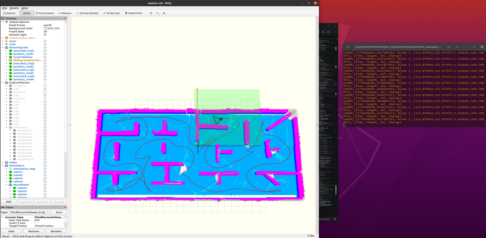

# 基于局部 ESDF 滑动窗口的 B 样条轨迹优化及无人机自主搜索研究：项目进展

## 基础改造（已完成）

### 局部 ESDF 窗口化

在 [sdf_map.cpp](../swarm_exploration/plan_env/src/sdf_map.cpp) 中实现局部 ESDF 更新窗口，以计算范围随无人机位置移动的方式维护滚动局部地图。

- 支持窗口尺寸配置、中心更新及地图边界裁剪。
- `updateESDF3d()` 根据开关选择局部窗口索引范围或原更新范围。
- 保留完整地图缓冲区与占据历史，滚动更新的是局部 ESDF 计算范围。
- 通过 [map_ros.cpp](../swarm_exploration/plan_env/src/map_ros.cpp) 发布窗口 Marker，便于检查窗口位置与边界。

### 动态滑动窗口

在 [planner_manager.cpp](../swarm_exploration/plan_manage/src/planner_manager.cpp) 中添加目标方向对齐，维护目标位置与方向状态；配合 [plan_container.hpp](../swarm_exploration/plan_manage/include/plan_manage/plan_container.hpp) 中的方向对齐椭球采样接口，为局部轨迹截取提供方向引导。

- 提供目标方向设置与动态窗口开关。
- 根据长、短半轴比例构造方向对齐的轨迹截取范围。
- 提供球形采样回退分支和目标方向可视化。

局部 ESDF 的轴对齐地图窗口与方向对齐的轨迹截取窗口分别作用于地图计算和轨迹处理，二者需要通过地图查询接口与规划流程协同工作。

## 当前运行效果

当前运行截图展示了室内障碍环境、地图显示、探索轨迹与局部窗口。RViz 显示列表包含 `Local Window` 和 `Sliding Window Dir`，便于观察窗口范围及目标方向。

基础改造完成状态按项目实际进展记录；该图作为运行与可视化展示。不同规划分支的采样调用覆盖、地图查询正确性和定量收益将通过后续模块测试与闭环实验进一步验证。

## 后续改进与测试

1. **地图有效性：** 验证窗口新进入区域、未知与过期数据、边界插值，以及窗口移动和 ESDF 更新的时序。
2. **方向机制：** 跟踪目标方向传递与椭球采样调用，补充急转弯、零方向、缺少引导轨迹和窗口边界等情况的回退与恢复检查。
3. **轨迹接口：** 在相同输入下比较规划耗时、优化状态、障碍间距及速度/加速度约束。
4. **闭环与消融：** 按开题报告实施 G0/G1/G2 对照，三类场景每组 5 个配对任务，共 45 次正式任务；必要时补充等预算诊断和参数敏感性实验。

具体评价指标与数据采集计划见[README](../README.md)，代码调用关系见[改动说明](RACER_CHANGES.md)，独立检查范围见[核验记录](VALIDATION.md)。
