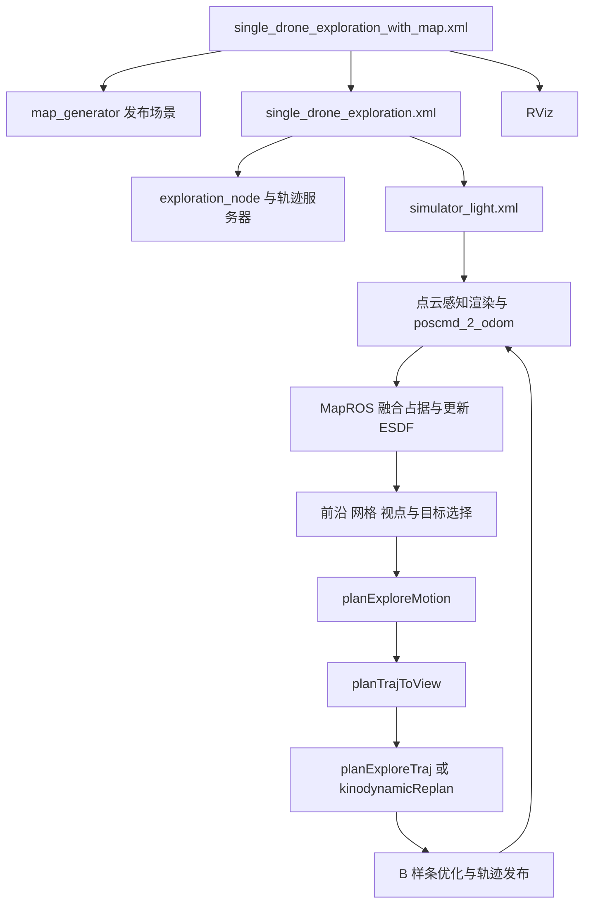

# VISTA 项目结构

本工程由 RACER 派生，源码按 ROS 1 catkin 包组织。理解时可先看探索决策、地图、规划管理三个层次，再看继承的样条与仿真模块。2026-11-16 使用 `catkin_pkg.packages.find_packages()` 检出 25 个有效包；磁盘上共有 26 份 `package.xml`，其中一份位于另一个包内部，并非额外独立包。

## 顶层内容

```text
VISTA/
├── README.md                  项目定位、状态和阅读入口
├── HANDOVER.md                继续研究的优先事项
├── THIRD_PARTY.md             来源、论文和第三方内容说明
├── docs/                      本次补充的结构、改动、复现和验证说明
│   └── upstream/              原 RACER README 原文
├── swarm_exploration/         探索、地图、规划与求解工具，11 个有效包
├── uav_simulator/             感知仿真、控制、消息与可视化，14 个有效包
├── files/                     RACER 原演示 GIF 等静态资源
├── test_single_drone.sh        带地图的单机启动脚本
├── test_with_map.sh            同一入口的兼容脚本
├── .gitignore                 构建产物、实验数据和本地文件排除规则
└── .gitattributes              脚本及源码的文本换行规则
```

当前目录若仍能看到历史 `build/`、`bin/`、`lib/` 文件，是为保留本地原件；发布提交已将 667 个历史生成文件移出 Git 索引。没有移动或删除算法源码，也没有重写上游提交历史。

## 探索与规划包

| 相对 `swarm_exploration/` 的目录 | 职责 | 本次核验发现的 VISTA 原有改动 |
| --- | --- | --- |
| `exploration_manager/` | 探索状态机、网格/前沿访问顺序、视点与运动规划衔接、launch 与 RViz | 更新窗口中心、设置方向目标、无网格回退、方向 Marker、参数和单机入口 |
| `plan_env/` | 占据地图、障碍膨胀、ESDF、ROS 地图回调和多机地图管理 | 局部 ESDF 窗口、更新范围切换、查询分支和窗口 Marker |
| `plan_manage/` | 路径与轨迹模块装配、轨迹生成和重规划、轨迹服务器 | 椭球采样、方向状态及参数、空邻机轨迹的 SWARM 处理 |
| `active_perception/` | 前沿发现、视点与感知工具、分层网格、轨迹可见性 | 继承原版；没有新增聚类拓扑算法 |
| `path_searching/` | A*、动力学 A* 与拓扑 PRM | 继承原版 |
| `bspline/` | 非均匀 B 样条表示、求导和参数化 | 继承原版 |
| `bspline_opt/` | 平滑、距离、可行性、边界、时间及机间等代价与优化接口 | 继承原版；调用方改变了是否启用 SWARM 代价 |
| `poly_traj/` | 多项式引导轨迹等基础表示 | 继承原版 |
| `traj_utils/` | 轨迹消息、可视化和相关辅助组件 | 继承原版 |
| `utils/lkh_tsp_solver/` | TSP 服务与接口 | 继承原版 |
| `utils/lkh_mtsp_solver/` | MTSP / ACVRP 求解服务与 LKH 相关实现 | 继承原版 |

`swarm_exploration/bag/` 为随上游保留的目录，不能据此认定已有本课题的正式实验数据。求解器 `resource/` 下的 `.par`、`.tour`、`.atsp` 等还可能是运行时生成物或示例问题，不是性能评价结果。

## 仿真与辅助包

| 相对 `uav_simulator/` 的目录 | 有效 ROS 包名 | 职责 |
| --- | --- | --- |
| `local_sensing/` | `local_sensing_node` | 点云/深度感知渲染；目录名与包名不同，当前 CMake 默认关闭 CUDA |
| `map_generator/` | `map_generator` | `.pcd` 场景发布与地图工具 |
| `poscmd_2_odom/` | `poscmd_2_odom` | 轻量位置指令到里程计仿真 |
| `so3_control/` | `so3_control` | SO(3) 控制器 |
| `so3_disturbance_generator/` | `so3_disturbance_generator` | 扰动生成 |
| `so3_quadrotor_simulator/` | `so3_quadrotor_simulator` | 四旋翼动力学仿真及其依赖源码 |
| `Utils/cmake_utils/` | `cmake_utils` | 构建辅助 |
| `Utils/multi_map_server/` | `multi_map_server` | 多地图消息与可视化 |
| `Utils/odom_visualization/` | `odom_visualization` | 飞行器和里程计显示 |
| `Utils/pose_utils/` | `pose_utils` | 位姿运算 |
| `Utils/quadrotor_msgs/` | `quadrotor_msgs` | 四旋翼公共消息 |
| `Utils/rviz_plugins/` | `rviz_plugins` | RViz 插件 |
| `Utils/uav_utils/` | `uav_utils` | 无人机通用工具 |
| `Utils/waypoint_generator/` | `waypoint_generator` | 航点工具 |

`Utils/multi_map_server/quadrotor_msgs/` 是上游历史嵌套副本；catkin 包扫描在父包处停止，不把它作为当前独立包。不要再手工把该目录加入同一工作空间，否则可能引入同名包冲突。

## 默认单机执行路径



图中 ESDF 定时更新与探索规划并非逐步同步调用。`planExploreMotion()` 在探索规划时改变窗口中心；`MapROS::updateESDFCallback()` 仍通过原定时器检查更新标志。

方向分支另在 `planGlobalTraj()` / `topoReplan()` → `paramLocalTraj()` → `getTrajInfoInEllipsoid()` 中。它未出现在上图默认探索链路内，详见[改动说明](RACER_CHANGES.md)。

## 建议阅读顺序

1. [single_drone_exploration_with_map.xml](../swarm_exploration/exploration_manager/launch/single_drone_exploration_with_map.xml) 与 [single_drone_planner.xml](../swarm_exploration/exploration_manager/launch/single_drone_planner.xml)。
2. [fast_exploration_manager.cpp](../swarm_exploration/exploration_manager/src/fast_exploration_manager.cpp) 中的 `planExploreMotion()` 和 `planTrajToView()`。
3. [sdf_map.cpp](../swarm_exploration/plan_env/src/sdf_map.cpp) 中的 `initMap()`、`updateESDF3d()`、`updateLocalWindowCenter()` 和 `getDistWithGrad()`。
4. [plan_container.hpp](../swarm_exploration/plan_manage/include/plan_manage/plan_container.hpp) 与 [planner_manager.cpp](../swarm_exploration/plan_manage/src/planner_manager.cpp) 中的方向采样路径。
5. [bspline_optimizer.cpp](../swarm_exploration/bspline_opt/src/bspline_optimizer.cpp) 的 `calcDistanceCost()`，理解 ESDF 查询如何进入原有代价函数。
